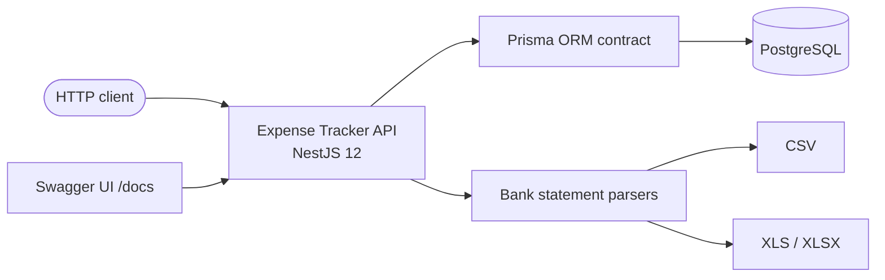
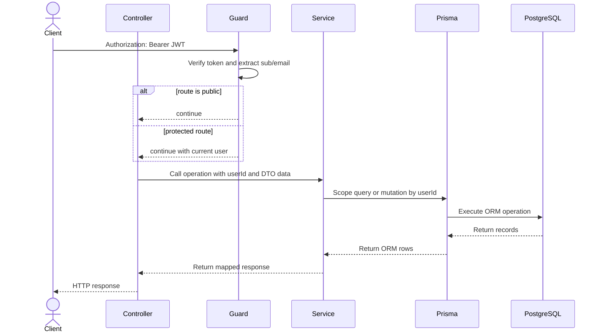
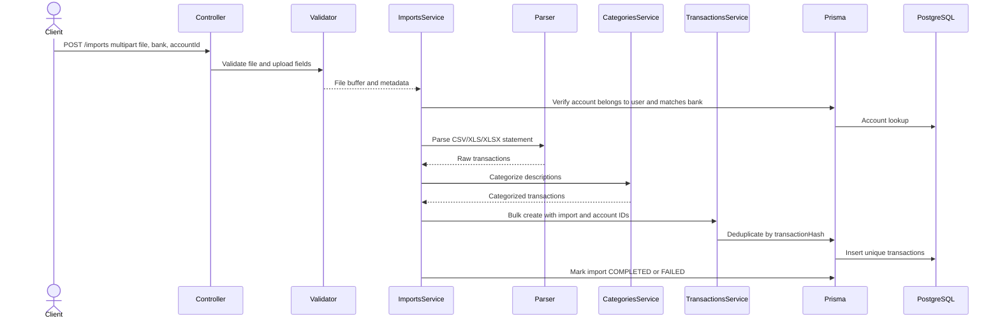

# Architecture

_Last reviewed: 2026-11-25_

## System context



The API provides HTTP endpoints for authentication, accounts, bank statement imports, transaction management, category rules, and expense statistics. It is a monolithic NestJS application backed by PostgreSQL.

## Components

| Component | Responsibility | Tech |
|---|---|---|
| `AppModule` | Application composition and feature-module wiring | NestJS |
| `AuthModule` | Registration, login, JWT bearer guards, and current-user resolution | NestJS JWT, bcryptjs |
| `UsersModule` | User persistence and public user projections | Prisma ORM contract |
| `AccountsModule` | Account listing and ownership checks | Prisma ORM contract |
| `TransactionsModule` | Filtering, retrieval, updates, deletion, import creation, and hash deduplication | Prisma ORM contract |
| `ImportsModule` | Multipart statement uploads, bank parser resolution, import lifecycle, and categorization | Express multipart, CSV, XLSX |
| `CategoriesModule` | Fixed categories, description classification, and category rules | TypeScript |
| `StatisticsModule` | Summary, category, and monthly expense calculations | TypeScript, Prisma ORM contract |
| `PrismaModule` | Database client lifecycle and generated Prisma contract access | Prisma ORM contract/Postgres runtime |
| Swagger setup | OpenAPI document and interactive `/docs` UI | `@nestjs/swagger` |

## Layered architecture

```text
HTTP controllers
      ↓
NestJS feature services
      ↓
Prisma ORM contract/client
      ↓
PostgreSQL
```

- Controllers validate input and delegate to services.
- Services own business rules and database operations.
- Feature services use `PrismaService.client.orm.public` rather than introducing a separate persistence abstraction.
- Bank parsers and statement-file validation remain separate from categorization and database writes.
- Services return mapped response objects instead of leaking ORM rows.

## Request flow



### Authentication

- `AuthGuard` is registered globally in `AuthModule`.
- `@Public()` marks intentionally unauthenticated endpoints; registration and login are currently public.
- `@CurrentUser()` supplies `{ id, email }` to controllers.
- JWT tokens contain `sub` and `email` and expire after seven days.
- Every user-owned data query and mutation must include `userId`.

## Statement import flow



The upload pipeline is:

1. Validate file size and statement format.
2. Resolve the `REVOLUT`, `MONOBANK`, or `PRIVAT` parser.
3. Parse statement transactions.
4. Apply category rules in descending priority.
5. Deduplicate transactions by global `transactionHash`.
6. Mark the import `COMPLETED` or `FAILED`.

Bank-specific implementations live under `src/imports/parsers/`. Raw parsing, categorization, and database persistence remain separate concerns.

## Data model

The Prisma contract is declared in `src/prisma/contract.prisma`:

| Entity | Purpose |
|---|---|
| `User` | Account identity and authentication data |
| `Account` | User-owned bank account metadata |
| `Import` | Statement upload lifecycle and status |
| `Transaction` | Stored income or expense record |
| `Category` | Fixed expense classification value |
| `CategoryRule` | Description-to-category matching rule |

Important invariants:

- Transaction amounts are positive stored values; `type` distinguishes income from expense.
- `transactionHash` is globally unique and supports import deduplication.
- Import statuses are `PENDING`, `PROCESSING`, `COMPLETED`, or `FAILED`.
- Every account and import operation must match the authenticated user.
- Category matching is case-insensitive against description substrings.
- Rules are ordered by descending priority.

## Categories

Fixed category values are:

`GROCERIES`, `RESTAURANTS`, `TRANSPORT`, `SHOPPING`, `ENTERTAINMENT`, `HEALTH`, `HOUSING`, `SUBSCRIPTIONS`, `SALARY`, `TRANSFER`, `OTHER`

Seed category rules are in `src/categories/category-rules.ts`. Classification should remain deterministic: description matching, case-insensitive, and priority ordered.

## Transaction filtering and statistics

`ParseTransactionFiltersPipe` parses category, type, date range, account, amount range, and text-search filters before database access.

Statistics endpoints calculate:

- Overall summary: `/statistics/summary`
- Category breakdown: `/statistics/by-category`
- Monthly expenses: `/statistics/monthly`

Calculations belong in `StatisticsService`. All queries must be scoped to the authenticated `userId`, and responses must be explicit interfaces rather than raw ORM rows.

## External dependencies

| Dependency | Purpose | Criticality |
|---|---|---|
| PostgreSQL | Durable account, import, transaction, category, and rule storage | Blocking |
| Prisma ORM contract/Postgres runtime | Generated ORM contract and PostgreSQL access | Blocking |
| JWT | Authentication and bearer authorization | Blocking for protected endpoints |
| CSV/XLS/XLSX libraries | Statement parsing | Blocking for imports |

There is no separate cache or queue in the current application. PostgreSQL is the source of truth, and import processing is synchronous within the HTTP request.

## API documentation

Swagger/OpenAPI is served at `/docs`. The `/auth/register` and `/auth/login` endpoints obtain JWT bearer tokens. Protected endpoints require the token in the `Authorization: Bearer <token>` header.

The Swagger document is generated from NestJS controller and DTO metadata in `main.ts` using `@nestjs/swagger`.

## Database evolution

- The schema contract is in `src/prisma/contract.prisma`.
- Generated contract files are under `src/prisma/`: `contract.json`, `contract.d.ts`, and database usage types.
- Migrations and snapshots live under `migrations/`.
- Contract changes must keep `contract.prisma`, generated output, migrations, snapshots, seed data, and feature code aligned.
- Generate emitted contract files with `pnpm contract:emit` where required.
- Inspect existing migration tooling and `prisma.config.ts` before applying schema changes.

## Environment

```bash
DATABASE_URL=postgresql://...
JWT_SECRET=<a private secret>
PORT=3000
```

- `DATABASE_URL` is required by `src/prisma/db.ts` and `prisma.config.ts`.
- `JWT_SECRET` secures tokens and falls back to `dev-secret` only in development code.
- `PORT` defaults to `3000`.

## Known constraints

- Import processing is synchronous and may hold the request open during file parsing and database writes.
- Import status is persisted in PostgreSQL; there is no background job or retry worker.
- `transactionHash` uniqueness is the primary cross-import deduplication mechanism.
- Parsing external spreadsheet formats requires validation before database writes.
- User-owned resources must remain scoped to `userId` even for reads and mutations that currently appear isolated.

## Architectural principles

- Controllers validate and delegate; services own business rules.
- Services and database operations scope all user-owned data by `userId`.
- Parsers are responsible only for external-format parsing.
- Database writes follow successful validation and categorization.
- Import deduplication is enforced through `transactionHash`.
- API responses use mapped public interfaces, not raw ORM records.
- Passwords, JWT secrets, database URLs, and uploaded financial contents must not be logged or committed.
