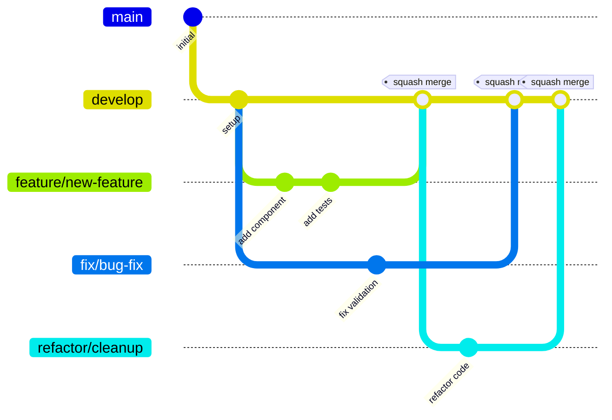
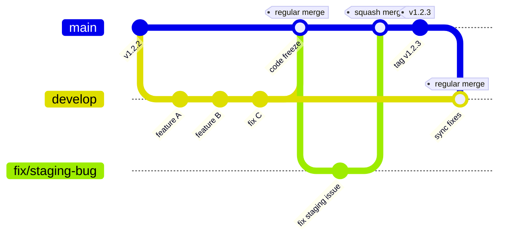
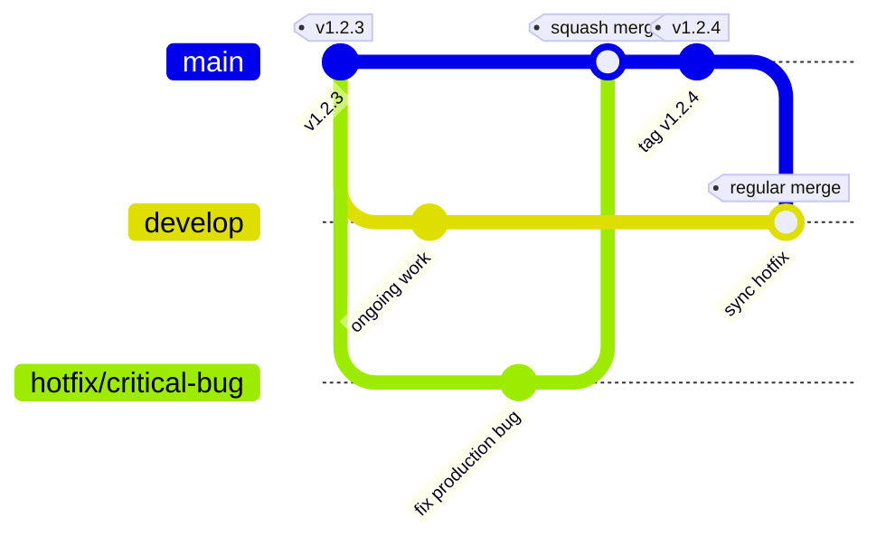
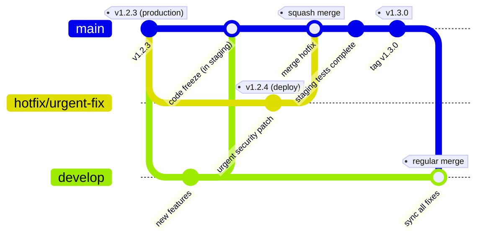

# Git Workflow Documentation

## Table of Contents

- [Overview](#overview)
- [Branch Structure](#branch-structure)
- [Development Workflow](#development-workflow)
- [Release Process](#release-process)
- [Hotfix Workflow](#hotfix-workflow)
- [Changelog Guidelines](#changelog-guidelines)
- [Visual Diagrams](#visual-diagrams)
- [Best Practices](#best-practices)

---

## Overview

This document describes our Git workflow strategy based on a **two-branch model** with `develop` and `main` branches. Our workflow emphasizes:

- Clear separation between development and production code
- Structured release cycles with code freeze periods
- Flexible hotfix handling for both normal and urgent situations
- Consistent commit and PR naming conventions
- Detailed changelogs for every release

All merging, tagging, and PR operations are done through **GitHub's UI**.

---

## Branch Structure

### Main Branches

Our workflow uses two permanent branches:

#### `main` Branch

- **Purpose**: Production-ready code
- **Deployment**: Staging environment (for final testing before production)
- **Protection**: Should only receive merges from `develop` (releases) or hotfix branches
- **Tags**: All production releases are tagged from this branch

#### `develop` Branch

- **Purpose**: Integration branch for ongoing development
- **Deployment**: Development environment
- **Activity**: Most active branch - receives all feature, fix, refactor, chore, and docs PRs
- **Stability**: Should always be in a working state
- **During code freeze**: Development continues normally - NOT blocked

### Working Branches

All development work happens on temporary branches created from `develop`. All working branches are squash merged to `develop` and deleted after merging.

**Branch naming conventions**:

- `feature/*` - New features or enhancements (e.g., `feature/user-authentication`)
- `fix/*` - Bug fixes (e.g., `fix/login-validation`)
- `refactor/*` - Code refactoring without behavior changes (e.g., `refactor/database-queries`)
- `chore/*` - Maintenance tasks, dependency updates, tooling (e.g., `chore/update-dependencies`)
- `docs/*` - Documentation updates (e.g., `docs/api-guide`)

### Hotfix Branches

**Hotfixes are only for bugs in production code.** If a bug is found during staging tests (code freeze), use a `fix/*` branch instead (see Release Process).

- **Naming**: `hotfix/*` (e.g., `hotfix/payment-error`, `hotfix/security-patch`)
- **Branch from**: `main` or latest production tag (e.g., `v1.2.3`) if needed during code freeze
- **Deploy from**: The branch itself for urgent fixes, or after merging to `main`
- **Merge to**: `main` via PR
- **Sync**: Create PR from `main` → `develop` after deployment (or included in next code freeze sync)

---

## Development Workflow

### 1. Creating a Working Branch

Update your local `develop` branch and create your working branch with the appropriate prefix (`feature/*`, `fix/*`, `refactor/*`, `chore/*`, or `docs/*`).

### 2. Making Commits

While working on your branch:

- **Write descriptive commit messages** starting with lowercase
- **No prefixes** in commit messages
- Each commit should represent a logical unit of work
- Commits will be shown in GitHub's squash merge UI and can be edited there

**Good commit messages**:

```
add user authentication middleware
update validation logic for email fields
fix null pointer in report generator
refactor database connection pooling
```

**Avoid**:

```
Feature: add user authentication  # ❌ No prefixes in commits
Add auth  # ❌ Should start with lowercase
fixed stuff  # ❌ Too vague
WIP  # ❌ Not descriptive
```

### 3. Creating Pull Requests

When your work is ready for review, create a PR on GitHub.

#### PR Title Format

**Required**: PR titles MUST include one of these prefixes:

- `Feature:` - New features or functionality
- `Fix:` - Bug fixes
- `Hotfix:` - Critical production fixes
- `Chore:` - Maintenance, dependencies, tooling
- `Refactor:` - Code refactoring without behavior changes
- `Docs:` - Documentation updates

**Examples**:

```
Feature: add user authentication with OAuth2
Fix: resolve login validation error
Chore: update dependencies to latest versions
Refactor: simplify report generation logic
```

#### PR Description

PR descriptions are optional but recommended. Add context, screenshots, testing notes, or anything that helps reviewers understand the changes.

#### Work in Progress PRs

If your PR is not ready for review:

- Mark it as a **Draft PR** in GitHub
- Add `[WIP]` before the prefix in the title (e.g., `[WIP] Feature: add user dashboard`)
- Convert to "Ready for review" when done

### 4. Squash Merge in GitHub

When the PR is approved:

1. Use GitHub's **"Squash and merge"** button
2. GitHub will show all commits from your branch
3. **The commit list is editable** - you can modify, reorder, or remove commits to create the squash commit description
4. The PR title becomes the final commit message in `develop`
5. Delete the branch after merging (GitHub offers this automatically)

**Squash commit description format** (for large PRs):

The PR title with number becomes the commit message. Use `*` for bullet points in the commit body:

```
Feature: add user authentication with OAuth2 (#123)

* add user authentication middleware

* update validation logic for email fields

* implement password reset functionality

* add unit tests for auth service
```

For small PRs, the commit description can be empty - just the PR title with number is fine.

### 5. Keeping Your Branch Up to Date

If your PR is long-lived and `develop` has moved ahead:

**Preferred approach** (if no conflicts expected):

- Rebase: `git pull origin develop --rebase`
- This keeps history cleaner

**If conflicts exist**:

- Use regular merge: `git pull origin develop --no-rebase`
- Resolve conflicts and push

---

## Release Process

### Phase 1: Code Freeze (Develop → Main Sync)

When you have enough features and fixes ready for production release:

1. Create a PR from `develop` → `main` in GitHub
2. Use **regular merge** (not squash merge)
3. PR title format: `"Develop to Main sync DD.MM"` (e.g., `"Develop to Main sync 01.01"`)
4. Merge the PR in GitHub UI

**What happens**:

- Code is automatically deployed to **staging environment**
- Testing phase begins
- **Important**: `develop` is NOT blocked - development work continues normally

### Phase 2: Staging Testing & Fixes

Test thoroughly on staging. If issues are found:

1. Create a fix branch from `main` (not `develop`)
2. Create PR targeting `main` (not `develop`)
3. PR title example: `"Fix: resolve validation error on staging"`
4. Squash merge to `main` in GitHub UI

**Important**: Staging fixes go directly to `main`, not `develop`. They'll be synced back to `develop` later.

### Versioning

We follow [Semantic Versioning](https://semver.org/) with the format `vMAJOR.MINOR.PATCH` (e.g., `v1.2.3`):

- **MAJOR** (v**2**.0.0) - Breaking changes or major architectural updates
- **MINOR** (v1.**3**.0) - New features or functionality (backward-compatible)
- **PATCH** (v1.2.**4**) - Bug fixes only (backward-compatible)

**Hotfixes** typically increment the PATCH version (e.g., `v1.2.3` → `v1.2.4`).

When deciding the version number, review all changes since the last release and choose the highest applicable level.

### Phase 3: Create Release Tag

Once staging tests pass:

1. Go to GitHub's "Releases" page
2. CI will usually create a draft release automatically
   - If not created, click "Draft a new release" to create it manually
3. Review and edit the changelog if needed (see [Changelog Guidelines](#changelog-guidelines))
4. Create a new tag (e.g., `v1.2.3`)
5. Publish the release
   - Publishing the release automatically triggers production deployment

### Phase 4: Production Deployment

- Monitor production for any issues
- Verify deployment success

### Phase 5: Post-Release Sync (Main → Develop)

After successful production deployment, sync fixes from `main` back to `develop` if there were any staging fixes:

1. Create a PR from `main` → `develop` in GitHub
2. Use **regular merge** (not squash merge)
3. PR title format: `"Main to Develop sync DD.MM"` (e.g., `"Main to Develop sync 01.01"`)
4. Merge the PR in GitHub UI

**Why**: This ensures any staging fixes made directly to `main` are now in `develop`.

---

## Hotfix Workflow

### Scenario 1: Standard Hotfix (No Code Freeze)

When a production bug is discovered and there's **no active code freeze**:

1. Create hotfix branch from `main`
2. Make fixes and commit
3. Create PR to `main` with `Hotfix:` prefix
   - Example: `"Hotfix: fix payment processing error"`
4. Squash merge to `main` in GitHub UI
5. Create and publish a new release tag (e.g., `v1.2.4`) - automatically deploys to production
6. **Sync back to develop**: Create PR from `main` → `develop` and merge

### Scenario 2: Urgent Hotfix (During Code Freeze)

When a critical bug needs **immediate fix** and staging is already being tested:

1. Create hotfix branch from the **latest production tag** (e.g., `v1.2.3`)
2. Make fixes and commit
3. Create a new tag from the hotfix branch (e.g., `v1.2.4`)
   - Publishing this tag automatically deploys to production
   - This allows immediate deployment without disrupting staging tests
4. After verifying the fix in production, create PR to merge into `main`
   - PR title example: `"Hotfix: patch security vulnerability"`
5. Squash merge to `main` in GitHub UI
6. The fix will be included in the next `main` → `develop` sync PR after the code freeze completes

**Key difference**: Urgent hotfixes are deployed from the branch before merging to `main`, allowing ongoing staging tests to continue uninterrupted.

---

## Changelog Guidelines

### Format

Changelogs are written in the release body when creating a tag in GitHub.

#### Structure

**Do NOT include a title/header** - GitHub generates the release title automatically from the tag.

```markdown
## 🚀 New Features

- Description of feature without prefix @username (#123)
- Another new feature @username (#124)

## 🐛 Bug Fixes

- Description of bug fix without prefix @username (#125)
- Another fix @username (#126)

## 🔧 Improvements & Enhancements

- Refactored component for better performance @username (#127)
- Enhanced error handling @username (#128)

## 🧹 Maintenance & DevOps

- Updated dependencies @username (#129)
- Improved CI/CD pipeline @username (#130)

**Full Changelog**: https://github.com/your-org/your-repo/compare/v1.2.2...v1.2.3
```

### Prefix to Category Mapping

When generating changelogs from PR titles, map prefixes to categories:

| PR Prefix         | Changelog Category                                        |
| ----------------- | --------------------------------------------------------- |
| `Feature:`        | **🚀 New Features** or **🔧 Improvements & Enhancements** |
| `Fix:`, `Hotfix:` | **🐛 Bug Fixes**                                          |
| `Refactor:`       | **🔧 Improvements & Enhancements**                        |
| `Chore:`, `Docs:` | **🧹 Maintenance & DevOps**                               |

### Generating Changelog

**What to include**: Only include changes that affect production users. If a bug was introduced and fixed in the same release cycle (never reached production), don't include the fix in the changelog.

1. Look at all PR titles merged between the previous release and current release
2. Remove the prefix from each title
3. Edit the message to be more user-friendly and readable if needed
4. Group by category
5. Add contributor's GitHub username with `@` and PR number in parentheses
6. Add "Full Changelog" link at the bottom comparing previous and current tags

**Example transformation**:

```
PR Titles (with contributors):
* Feature: Add export functionality by @johndoe (#145)
* Fix: Resolve login timeout by @janedoe (#146)
* Chore: Update Node.js to v20 by @johndoe (#147)
* Refactor: Optimize database queries by @janedoe (#148)

Becomes:

## 🚀 New Features
- Add export functionality @johndoe (#145)

## 🐛 Bug Fixes
- Resolve login timeout @janedoe (#146)

## 🔧 Improvements & Enhancements
- Optimize database queries @janedoe (#148)

## 🧹 Maintenance & DevOps
- Update Node.js to v20 @johndoe (#147)

**Full Changelog**: https://github.com/your-org/your-repo/compare/v1.2.2...v1.2.3
```

---

## Visual Diagrams

### Normal Development Flow



### Release Process Flow



### Hotfix Flow - Standard



### Hotfix Flow - Urgent (During Code Freeze)



---

## Best Practices

### Code Review

- Keep PRs focused and reasonably sized
- Respond to feedback promptly
- Don't merge your own PRs without review (unless emergency)
- Use GitHub's "Request changes" / "Approve" features

### Conflict Resolution

When conflicts occur:

1. **During PR**: Merge updates from base branch and resolve conflicts
2. **During release merge**: Carefully resolve - this affects production
3. **Ask for help** if unsure about resolution
4. **Test after resolving** - don't assume the merge is correct

### Communication

- Use PR descriptions to explain context and decisions
- Tag relevant team members for review
- Communicate code freezes to the team in advance
